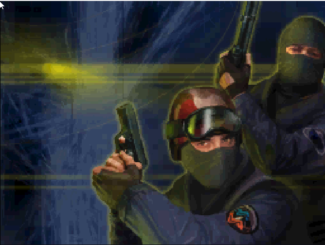
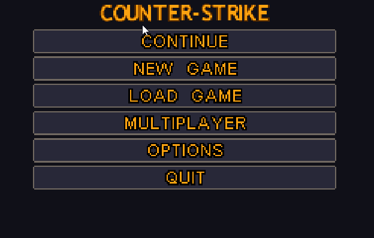
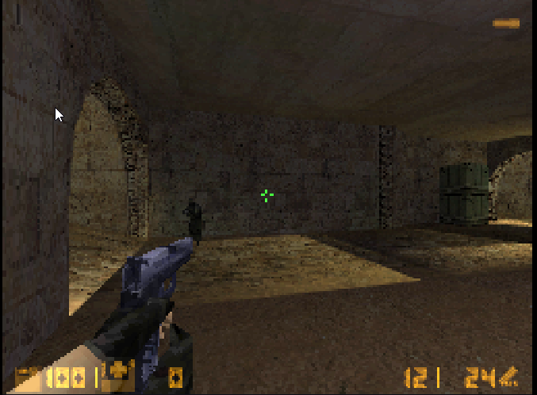
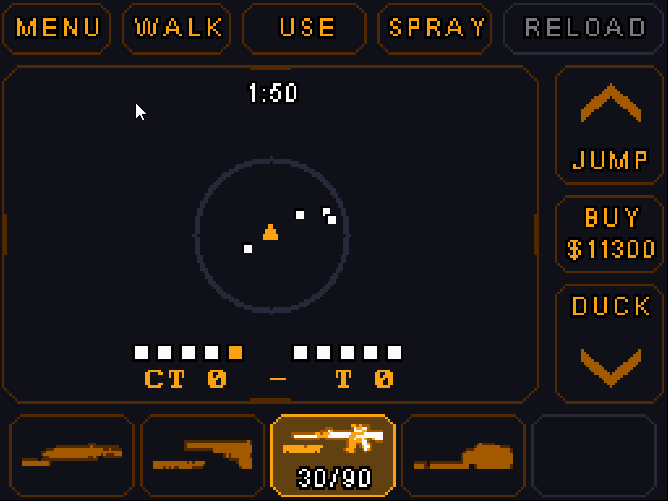

# Counter-Strike 1.6 DS

Counter-Strike 1.6 on the Nintendo DS, DSi and 3DS. Bomb defusal on de_dust2, de_nuke and de_inferno, against bots or with friends over local wireless.

**No game files are in this repository or in any download.** You bring your own copy of Counter-Strike 1.6, and the installer turns it into a ROM for your console on your own computer.

This is an unofficial fan project. It is not affiliated with or endorsed by Valve.

<p>


</p>
<p>


</p>

The screenshots are real captures from melonDS. The art in them comes from the owner's own copy of the game.

## How close is it to 1.6?

The maps, models, sounds and textures are your own copy's, converted for the DS. The game itself runs on a new engine written for the DS, and the Counter-Strike rules were written from scratch to play like 1.6. Valve never published Counter-Strike's game code, so the numbers were checked against [ReGameDLL_CS](https://github.com/s1lentq/ReGameDLL_CS), an open reimplementation of the 1.6 server. They cover:

- prices, damage and how it falls off with distance;
- the buy menu's names and order, and the price of each box of rounds;
- magazines and reloads;
- armour;
- running speed for each weapon, scoped or not;
- the bomb's and the HE grenade's blasts;
- how the bots buy and throw grenades.

1.6 has no bots of its own. The bots here follow Condition Zero's, whose rules ReGameDLL_CS also has.

It's a faithful remake on the original content, not the PC game running unchanged. The differences are listed below.

## Features

- **Bomb defusal**, played as 1.6 plays it:
  - rounds and freeze time;
  - the buy zone and buy time;
  - money for kills and round wins;
  - planting and defusing the C4, with or without a defuse kit;
  - a blast that hurts everyone near it, through walls, on either team.
- **Three maps with bots that know them**: de_dust2, de_nuke and de_inferno. Each has its own routes, holding spots and callouts (long A, banana, apartments, mid, outside, ramp and more).
- **Bots on both sides**, after Condition Zero's:
  - they take routes to a site, hold angles, rotate, retake, and pick up a dropped bomb;
  - they buy as those bots do, a grenade now and then included, and throw it at whoever they're fighting;
  - a counter-terrorist bot sometimes buys the tactical shield instead of a rifle;
  - like Condition Zero's bots, they never buy night vision.
- **The radio, for both teams, alive or dead**:
  - Tell your bots where to go: BOMB A, BOMB B, PUSH, SPREAD, RETAKE, FOLLOW ME, HOLD, and each map's callouts.
  - Drop the bomb for a teammate.
- **The 1.6 buy menu**, with each team's own list under 1.6's names (CV-47, Maverick M4A1 Carbine, Night Hawk .50C and so on):
  - every pistol, shotgun, SMG, rifle and sniper rifle, and the M249;
  - Kevlar, helmet and defuse kit;
  - HE grenade, flashbang and smoke grenade;
  - night vision goggles;
  - the tactical shield;
  - PRIMARY AMMO and SECONDARY AMMO: as in 1.6, a gun comes with one magazine, and the rest is bought by the box.
- **Silencers**: R puts the M4A1's or the USP's silencer on and takes it off, with 1.6's quieter shot, damage and spread.
- **Running speed by weapon**, as in 1.6: 250 with the knife or a pistol, 221 with the AK-47, 210 with the AWP, and slower again with a sniper's scope up (150 with the AWP). Walking is 52% of running.
- **Damage that falls off with distance**, by each gun's own rate: an AK-47 round loses little, a Glock's a lot.
- **Grenades as in 1.6**: the HE does 100 at its middle and nothing past 350 units, through walls, and never hurts your teammates.
- **Night vision goggles**: touch the NVG slot to switch them on and off.
- **The tactical shield**: held with a pistol, the knife or a grenade. Raise it with the second trigger (R) or by touching its slot. Raised, it covers more of you, but you can't fire and you move slower.
- **Local wireless matches**, up to 4 against 4, with bots filling the teams. Every player appears in their team's model.
- **Sprays**, in matches and against bots.
- **Touch-screen controls** for either hand, with the radar, round clock, score and buy menu on the bottom screen.

## What's missing

- Hostage rescue (cs_), VIP (as_) and escape maps: only bomb defusal is played.
- Maps other than de_dust2, de_nuke and de_inferno have no bot routes yet.
- Bullets don't go through walls yet.
- Bots don't raise their shields.
- Bomb cant be dropped yet
- Sub-factions aren't implemented yet 
- Online play: matches are local wireless only. A DS can't play against PC players.
- Big servers: the DS's wireless allows a few consoles per match, not 32 players.

## Not fully working yet

- **DS Download Play** (a console with no card getting the game from one that has it):
  - The receiving console has to open DS Download Play from TWiLight Menu++ (v27.25.0 or later): its SELECT menu, the DS Classic Menu, or the small icon in the 3DS-style menu. That Download Play skips Nintendo's signature check.
  - Opened from the 3DS HOME Menu or the DSi Menu, Download Play receives the game and then stops on a blank screen.
  - Only de_dust2 fits in a receiving console's memory. de_nuke and de_inferno are too big to send.
  - In melonDS, the receiving console freezes after the transfer, because the emulated firmware checks the signature too.
  - A receiving DS in DS mode holds some guns as another of their kind (a Galil as the AK-47, for example). It has no shield models and no night vision sounds.

## Future Version Plans:
- Adding new maps including cs_office, a mirage port, and an Ancient port from CS2
- Bots should be able to pick up bomb after player drops it soon
- Sub-factions such as the leet crew and arctic avengers being selectable
- Possible Valorant demake based off of this?

## Supported consoles

| Console | How |
|---|---|
| 3DS | TWiLight Menu++, in DSi or DS mode |
| DSi | TWiLight Menu++, hiyaCFW or Unlaunch |
| DS, DS Lite | A flashcard: not yet confirmed on hardware |
| melonDS | DS mode, with the ROM made for an emulator |

DSi mode has more memory, so it gets richer content than DS mode.

## Installing

You need:
- Counter-Strike 1.6 installed from Steam (it comes with the Half-Life files it is built on);
- your console's SD card;
- about 1 GB free on your computer while the installer works.

1. **Download the installer** for your system from the [Releases](../../releases) page, and unzip it.
2. **Run it** (`hlds-convert-gui`). It finds your Counter-Strike and your SD card by itself, and asks which console the card is for. It converts the three maps into `_nds/hl_nds/data` on the card and puts the ROM, **`cs16-ds.nds`**, at the card's root. This takes a few minutes.
3. **Start `cs16-ds.nds`** from TWiLight Menu++ or your loader.

The ROM holds none of the game: it reads your converted copy from the card. **The converted game on your card is your own copy, so don't share it.** Everyone converts their own.

## Controls

| | |
|---|---|
| Stylus drag | Look |
| D-pad | Move |
| L | Fire |
| R | Second trigger: the scope, the M4A1's or USP's silencer, or raising the shield |
| Touch screen | BUY / RADIO, weapon slots, JUMP, DUCK, USE, RELOAD, SPRAY, WALK |
| Weapon slot 5 | The bomb (planting), and the night vision goggles |
| Start, or MENU | Pause |

Choose between the CLASSIC and MODERN layouts in OPTIONS > CONTROLS.

## Building from source

Everything builds in a container, so only [Docker](https://docs.docker.com/get-docker/) is needed:

```sh
docker compose run --rm dev ./make.sh
docker compose run --rm dev cmake -S tools/hlds-convert -B build/convert -DHLDS_BUILD_GUI=OFF
docker compose run --rm dev cmake --build build/convert -j4
```

The first command builds the console program. The next two build the converter. More is in [CONTRIBUTING.md](CONTRIBUTING.md), and the engine is described in [docs/TECHNICAL.md](docs/TECHNICAL.md).

## Credits

- **xRex1984**: Counter-Strike 1.6 DS.
- Built on **[Half-Life for Nintendo DS](https://github.com/CrowbarDS/Half-Life-NDS-Port)**, the CrowbarDS port. Its engine, converter and installer are the base of this project.
- [ReGameDLL_CS](https://github.com/s1lentq/ReGameDLL_CS) (MIT): the reference used for 1.6's numbers and rules. None of its code is copied here.
- [BlocksDS](https://blocksds.skylyrac.net/) and the [Wonderful Toolchain](https://wonderful.asie.pl/): the SDK and compilers.
- [Nitro Engine](https://github.com/AntonioND/nitro-engine) by Antonio Niño Díaz, through the [Nitro Engine Advanced fork](https://github.com/Warioware64/nitro-engine).
- [dswifi](https://github.com/blocksds/dswifi), through the [fork](https://github.com/Warioware64/dswifi) with Download Play.
- [teak-llvm](https://github.com/Gericom/teak-llvm) by Gericom, and [libteak](https://github.com/blocksds/libteak).
- [ptexconv](https://github.com/Garhoogin/ptexconv) by Garhoogin, [meshoptimizer](https://github.com/zeux/meshoptimizer) by Arseny Kapoulkine, [minimp3](https://github.com/lieff/minimp3), [yas](https://github.com/niXman/yas), [Qt](https://www.qt.io/) and [ArchitectDS](https://github.com/AntonioND/architectds).
- [TWiLight Menu++](https://github.com/DS-Homebrew/TWiLightMenu), whose Download Play lets an unsigned game in.

Counter-Strike and Half-Life are trademarks of Valve Corporation. The engine's game code is adapted from the Half-Life SDK, and parts of it follow the structure of Xash3D FWGS.

## Licence

The licences are as in the Half-Life port this is built on:

- The game code is adapted from the Half-Life SDK and distributed under Valve's [Half-Life 1 SDK licence](LICENSE-HALF-LIFE-SDK) (free, non-commercial).
- Parts of the engine code are adapted from Xash3D FWGS (GPL-3.0-or-later).
- Each third-party component's licence is in [THIRD_PARTY_LICENSES](THIRD_PARTY_LICENSES).

## Use of AI

This project was developed with the help of AI coding assistants. Every change is reviewed and tested by the author. No art, sound or screenshot in it is AI-generated.
